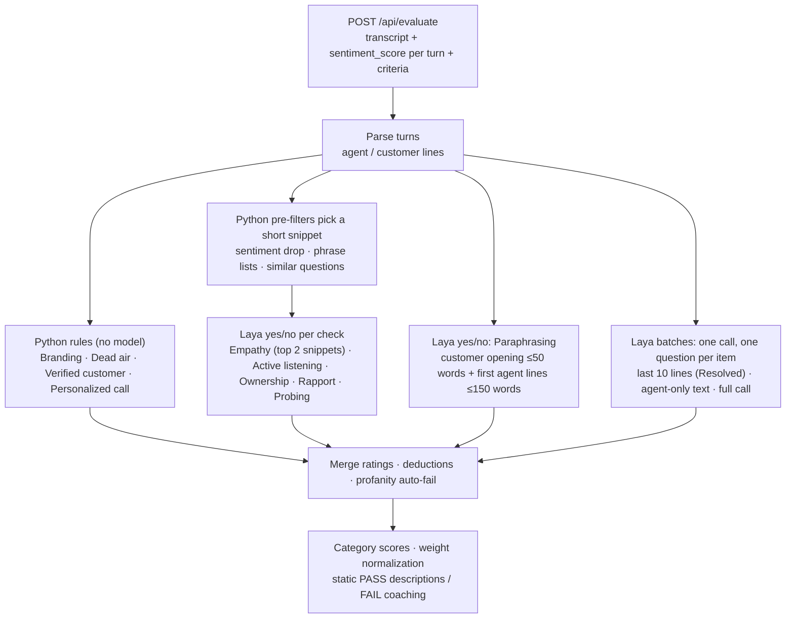
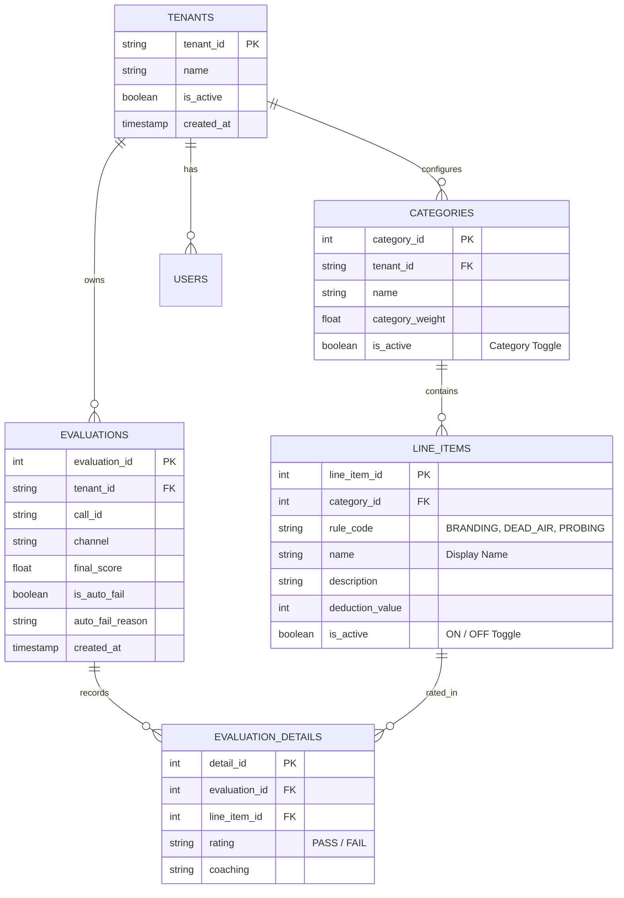

# System Architecture & Technical Specifications

This document specifies the **Automated QA Analysis System**: the evaluation lifecycle, dynamic multi-tenant criteria selection, the deterministic rules, the Laya decision engine, and score normalization.

---

## 1. Master Pipeline Architecture

The system grades customer support interactions with a **hybrid of deterministic Python rules and the Laya decision engine**. Exact checks (scripts, timing, identity verification, profanity) run in plain Python. Judgement calls (empathy, rudeness, deflection, probing and so on) are yes/no questions answered by Laya.

Laya (`../laya-test/laya`) is a local, non-generative classifier. It returns a yes-probability per question in one forward pass and cannot write text. That is why every model input is kept short and pre-filtered, and why coaching tips are static text.



---

## 2. Dynamic Multi-Tenant Criteria Engine

### 2.1 Dynamic Criteria Selection (`selected_criteria`)
All line items inside the tenant's categories are extracted into a normalized lowercase Python `set`:
```python
selected_criteria = {
    item.get("name", "").strip().lower()
    for cat in categories
    for item in cat.get("line_items", [])
}
```
Each check runs **if and only if** its name exists in `selected_criteria`:
```python
if "branding and survey check" in selected_criteria:
    rule_ratings.append(evaluate_branding(turns))
```
Unselected criteria are skipped entirely: no model calls and no deductions.

Built-in checks are matched by **exact name**, so renaming a built-in item in the database moves it to the generic batch path. Any other active item is rated by Laya in a batch using a question built from its name and description. A description starting with `VIOLATION-BASED` is asked as "did the agent violate this?"; anything else is asked as "did the agent do this?".

### 2.2 Dynamic Category Weight Normalization (`calculate_category_scores`)
When a tenant disables or omits categories, the remaining weights are re-balanced so a perfect call still scores 100.

For the evaluated categories $C_1, \dots, C_k$ with base weights $w_i$:

$$W_{\text{active}} = \sum_{i=1}^{k} w_i \qquad w_i' = \frac{w_i}{W_{\text{active}}} \qquad \text{Final Score} = \sum_{i=1}^{k} \left( \text{Score}_{C_i} \times w_i' \right)$$

Each category starts at 100 and loses each failed item's `deduction_value` (floor 0).

### 2.3 Static PASS descriptions and FAIL coaching
Laya cannot generate text, so the scorecard text is static:
* **PASS:** `RULE_BASED_PASS_DESCRIPTIONS` in `dynamic_evaluator.py`.
* **FAIL:** each check's own message (for example "Agent used rude or condescending language."), then `RULE_BASED_FAIL_COACHING` for batch-rated items, then a generic "Criteria standard for '…' was not met."

---

## 3. The 11 QA Evaluation Criteria

### Category 1: Soft Skills (Default Weight: 33.3%)
1. **Branding and Survey Check** (`evaluate_branding`, rule): `"thank you for calling s-net"` in the first 4 agent turns and `"thank you for choosing s-net"` in the last 4.
2. **Hold time and Dead Air** (`evaluate_hold_and_dead_air`, rule): gaps over 30 s between turns; **2 or more** such gaps fail.
3. **Personalized the call/ticket appropriately** (`evaluate_personalized_call`, rule): the request's `customer_name` appears in an agent line.
4. **Empathy & Acknowledgment Statement** (Laya):
   * A snippet is taken when a customer turn's `sentiment_score` is ≤ -15 or drops ≥ 8 versus any of the previous 3 turns.
   * It is skipped if the agent apologises within 3 turns. Each snippet is the customer turn plus the next 4 turns.
   * Only the **2 most severe, non-overlapping** snippets are checked, one Laya call each. One FAIL fails the item.
5. **Build rapport and observed professionalism** (Laya, violation-based): agent lines containing a rude phrase (`"calm down"`, `"read the manual"` …) are sent to Laya. No hit means PASS.

### Category 2: Technical Knowledge (Default Weight: 66.7%)
6. **Paraphrasing** (Laya): the customer's opening (≤ 50 words) and the first 10 agent lines (≤ 150 words) are sent with the question "does the agent restate the customer's problem?". This criterion is new on Laya and not yet calibrated.
7. **Verified customer** (`evaluate_verified_customer`, rule): `\b(pin|address|security question)\b` in an agent line within the first 240 s.
8. **Probing** (Laya):
   * No agent questions at all means FAIL without a model call.
   * Otherwise greeting, identity-check, confirmation and wrap-up questions are dropped. The remaining questions (≤ 100 words) plus the customer problem (≤ 50 words) go to Laya.
9. **Took ownership of the problem** (Laya, violation-based): agent lines containing a deflection phrase (`"not my department"`, `"call back"` …) are sent to Laya. No hit means PASS.
10. **Active listening** (Laya): pairs of agent questions with a `difflib` similarity above 0.70 are sent to Laya as possible repeats.
11. **Confirmed the issue is resolved** (Laya batch): the **last 10 lines** of the call.

Escalation, Hostility and custom criteria (if a tenant adds them) are rated in Laya batches. Escalation and Hostility use the full call, which goes through Laya's windowed `predict_long` when it is longer than one window.

### Thresholds
Each Laya check has a `pass_threshold` in `LAYA_CHECKS` (`dynamic_evaluator.py`). The values come from a synthetic out-of-the-box test (`../laya-test/qa_eval/RESULTS.md`). Checks on the full-length sample calls show several do **not** transfer yet: Confirmed-resolved fails almost every call, Rapport is inverted, and Paraphrasing doesn't separate. Treat them as starting values to re-tune on human-reviewed calls.

### Category 3: Auto-Fail Circuit Breakers
* **Profanity & abuse:** a fixed word list (`"fuck"`, `"shut up"`, `"idiot"`, …) anywhere in the transcript forces a score of 0.
* **Scorecard circuit breaker:** any item in a category whose name contains "AUTO FAIL" that is rated FAIL forces a score of 0.

---

## 4. Database Schema Roadmap (Multi-Tenant Architecture)

The live tables are `tenants`, `categories`, `line_items` and `tenant_lines` (per-tenant `is_active` toggle) in `src/db/database.py`. The roadmap below adds evaluation history and a `rule_code` so built-in rules no longer depend on display names.



---

## 5. Codebase Map & Module Reference

| File Path | Description |
|---|---|
| `main.py` | QA service launcher (port 8006). Loads `.env`. |
| `run_gateway.py` | API Gateway launcher (port 8005). |
| `src/api/web_app.py` | FastAPI app: `/api/evaluate`, criteria/tenant CRUD, samples. |
| `src/api/logger.py` | Structured JSON request logger. |
| `src/gateway/gateway_app.py` | Gateway reverse proxy plus direct PostgreSQL routes for criteria fetch and toggle. |
| `src/db/database.py` | PostgreSQL data layer (tenants, categories, line items, toggles). |
| `src/services/dynamic_evaluator.py` | Orchestrator: criteria selection, input caps, Laya questions and thresholds, batches, scoring, static coaching. |
| `src/services/rule_engine.py` | Deterministic rules and snippet pre-filters (empathy, ownership, rapport, active listening, probing inputs). |
| `src/services/laya_adapter.py` | Loads the Laya `Router` once and exposes `predict_yes()`. |
| `resources/criteria_config.json` | Reference criteria for tenant-abc (also used by the check script). |
| `Scripts/check_prompt_sizes.py` | Verifies input sizes and scorecards over all sample calls (`--live` runs real Laya). |
| `Scripts/batch_test.py` | Posts every `inputs/*.json` to `/api/evaluate` and saves results. |
| `Docs/PIPELINE_FLOWCHART_LAYA.md` | Pre-migration analysis of what Laya could replace. |
| `Docs/postman_collection.json` | Postman collection for the API. |
