# Flow diagrams: how a call becomes a score (as of 2026-10-22)

> **Status on `main` (27 Oct 2026):** this page describes the earlier `app-v3` branch. On `main` the job queue (`/api/jobs`, `src/v3/jobs.py`) and `docker-compose.v3.yml` were removed: `/api/evaluate` is synchronous, tenant scorecards come from PostgreSQL with the built-in 11 items as fallback, and the Docker setup is `docker-compose.yml` with the fine-tuned weights mounted from `models/`. The current deployment guide is [`DEPLOYMENT_PLAN.md`](../DEPLOYMENT_PLAN.md).

Nine diagrams, from the big picture down to one model call, plus how the model and the new checks were built. They draw what the code does today on branch `app-v3`. Under each diagram a table names the file and function behind every box, so a statement on a slide can be checked in the code in a minute. Read [`CODEBASE_GUIDE.md`](CODEBASE_GUIDE.md) first if the words "v2", "v3", "flow", "gate" or "cutoff" are new.

> **Every accuracy figure in this repo is measured against AI-written answer keys, not human-labelled ones.** Diagrams 8 and 9 mention results; read them with that in mind.

Colour legend used in diagrams 6 to 9: grey = plain Python rule, no model; blue = model check, unchanged from v2; green = model check with a new v3 gate that is switched on; orange = tried, did not win, switched off.

Contents: [1 System map](#1-system-map) · [2 Which pipeline runs](#2-which-pipeline-runs) · [3 Pipeline v2](#3-pipeline-v2-the-original-flow-one-request) · [4 Pipeline v3](#4-pipeline-v3-the-new-flow-one-request) · [5 One model call](#5-inside-one-model-call) · [6 The 11 checks](#6-the-11-checks-side-by-side) · [7 Scoring](#7-how-the-score-is-built) · [8 How a gate is chosen](#8-how-a-new-gate-is-chosen-and-switched-on) · [9 How the model is built](#9-how-the-model-and-the-test-sets-were-built)

---

## 1. System map

Who talks to whom when the whole stack is running. In v3 mode the database box is not used at all.

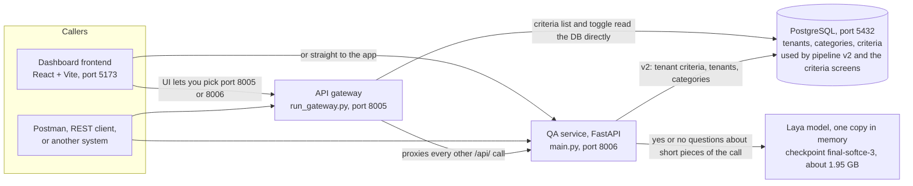

| Box | Where it is in the code | Note |
|---|---|---|
| Frontend | `frontend/src/App.jsx` (`apiBase` is `http://<host>:<port>/api`, port chosen in a drop-down) | Manages tenants and criteria, sends sample calls to `/api/evaluate` |
| Gateway | `run_gateway.py` starts `src/gateway/gateway_app.py` | Two routes talk to the DB itself; everything else is forwarded to `APP_URL` (default `http://localhost:8006`) |
| QA service | `main.py` starts `src/api/web_app.py` | All endpoints, the evaluators, the v3 queue |
| Database | `src/db/database.py` (`DB_HOST`, `DB_PORT`, `DB_NAME`, `DB_USER`, `DB_PASSWORD`) | Needed by v2 and by the tenant and criteria screens. v3 grades against `src/v3/config/criteria.json` and never opens a connection |
| Model | `src/services/laya_adapter.py` | One copy, guarded by a lock: it answers one question at a time |

---

## 2. Which pipeline runs

Two settings decide what happens to a request: `LAYA_FLOW` and whether `LAYA_CHECKPOINT` is set. Today `.env` sets the checkpoint and does not set `LAYA_FLOW`, so **pipeline v2 with flow v2 windows is what runs by default**. Setting `LAYA_FLOW=v3` switches to the new pipeline.

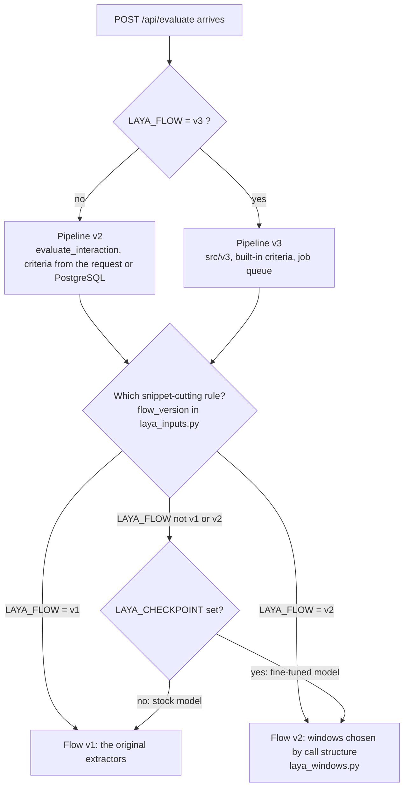

| Setting | Effect | Where |
|---|---|---|
| `LAYA_FLOW=v3` | Selects pipeline v3 (also `/api/jobs` exists, the DB is not used) | `src/api/web_app.py` `_v3_enabled()` |
| `LAYA_FLOW=v1` or `v2` | Forces the snippet-cutting rule | `src/services/laya_inputs.py` `flow_version()` |
| `LAYA_CHECKPOINT` set | Loads the fine-tuned weights, applies the fine-tuned cutoffs, and (if `LAYA_FLOW` is unset or `v3`) uses flow v2 windows | `laya_adapter.py`, `dynamic_evaluator.py` `FINETUNED_CUTOFFS`, `flow_version()` |
| `LAYA_AL_SOURCE2=1` | Adds a second source of candidate pairs for Active listening; only for ft5 and ft6, off for production | `laya_inputs.py` `al_source2_enabled()` |

Pipeline v3 reuses the flow v2 window builders for the checks it has not changed, so "v3" and "flow v2" are not alternatives: v3 is the pipeline around them.

---

## 3. Pipeline v2 (the original flow), one request

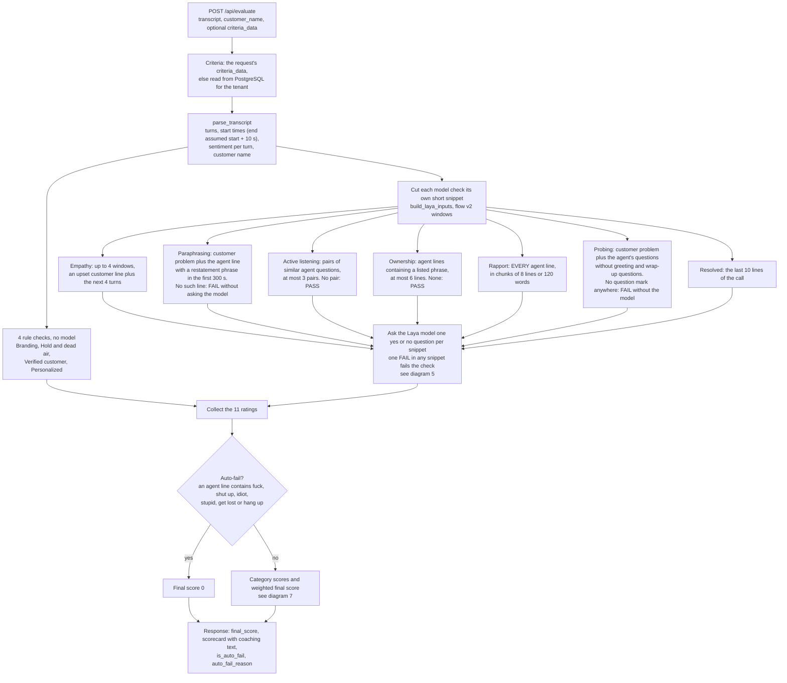

| Box | Code |
|---|---|
| Endpoint | `src/api/web_app.py` `evaluate_tenant_transcript` -> `src/services/dynamic_evaluator.py` `evaluate_interaction` |
| Criteria from DB | `src/db/database.py` `get_active_criteria_for_evaluation` |
| Parse | `src/services/laya_inputs.py` `parse_transcript`, `build_laya_inputs` |
| Rule checks | `src/services/rule_engine.py` `evaluate_branding`, `evaluate_hold_and_dead_air`, `evaluate_verified_customer`, `evaluate_personalized_call` |
| Empathy windows | `src/services/laya_windows.py` `empathy_episode_windows` (trigger: sentiment at or below -15, or a frustration word) |
| Paraphrasing window | `laya_windows.py` `paraphrase_window` (cue regex `_PARAPHRASE_CUE`) |
| Active listening pairs | `rule_engine.py` `extract_active_listening_snippets` (difflib similarity above 0.55) |
| Ownership phrases | `laya_windows.py` `ownership_candidates` (`_OWNERSHIP_PHRASES`, `_OWNERSHIP_RE`) |
| Rapport chunks | `rule_engine.py` `extract_rapport_chunks` |
| Probing input | `rule_engine.py` `extract_probing_inputs` (50 words of problem, 100 words of questions) |
| Resolved window | `laya_inputs.py`: `clean_lines[-RESOLVED_TAIL_LINES:]`, 10 lines; asked as a "batch" item by name in `evaluate_interaction` |
| Auto-fail | `dynamic_evaluator.py` `check_auto_fail` (plain substring match on agent text) |
| Score | `dynamic_evaluator.py` `calculate_category_scores` |

Things v2 does that v3 deliberately does not: it assumes every turn lasts 10 seconds, so dead air is guessed; its criteria query is not limited to the tenant's own categories; it matches the auto-fail words as substrings ("that's not a stupid question" zeroes a call); a tenant whose category names differ from "Soft Skills" and "Technical Knowledge" silently gets 100.

---

## 4. Pipeline v3 (the new flow), one request

Three layers: the web layer protects the service, the queue makes sure the single model is used by one call at a time, and the worker does the grading.

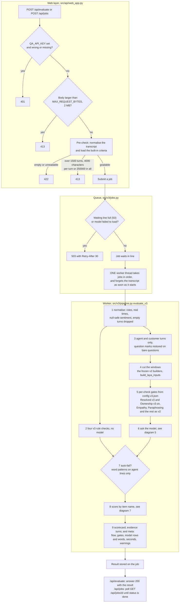

How the two entry points behave when the line is busy:

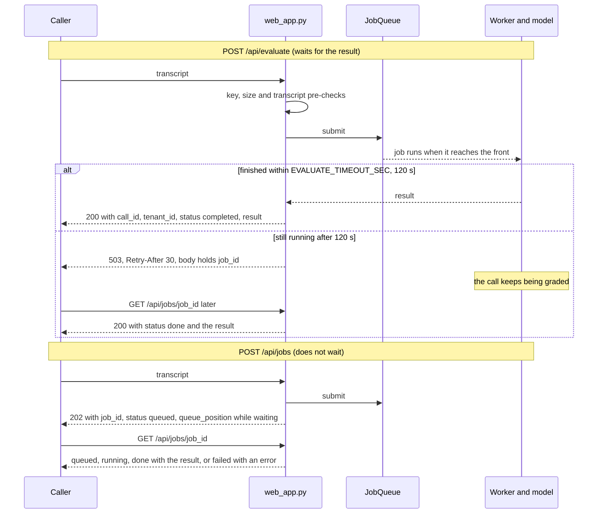

| Box | Code |
|---|---|
| API key, size limit, redacted log | `web_app.py` `log_requests_middleware`, `_api_key_ok`, `_safe_body`, `MAX_REQUEST_BYTES` |
| Pre-check and submit | `web_app.py` `_submit_v3`; errors mapped by `_error_status` (`InvalidTranscript` and `NoCriteria` -> 422, `TranscriptTooLarge` -> 413) |
| Queue and worker | `src/v3/jobs.py` `JobQueue` (bounded by `QUEUE_MAX`, default 50; finished jobs are forgotten after 3600 s) |
| Model loads at startup | `web_app.py` `_warm_model`; `/ready` answers 503 until it has loaded |
| Normalise | `src/v3/normalise.py` `normalise` (limits in `src/v3/config/v3.json`) |
| Rules | `src/v3/rules.py` `evaluate_branding`, `evaluate_dead_air`, `evaluate_verified`, `evaluate_personalized`, `check_auto_fail` |
| Question marks | `src/v3/text.py` `add_question_marks`, used by `pipeline._v2_transcript` |
| Windows | `src/services/laya_inputs.py` `build_laya_inputs` (frozen, unchanged) |
| Gates | `pipeline._model_ratings`; the switches are the `gates` block of `src/v3/config/v3.json`; the windows are in `src/v3/candidates/` |
| Scoring | `src/v3/scoring.py` `score` |
| Built-in criteria | `src/v3/config/criteria.json` (a copy of the default set; `criteria_data` in a request is ignored) |

---

## 5. Inside one model call

Every model check, in both pipelines, ends here. The model never writes text: it returns the probability that the answer to one typed question is "yes".

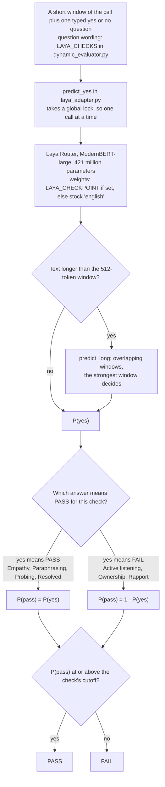

Cutoffs in force with the fine-tuned checkpoint (`FINETUNED_CUTOFFS` and `LAYA_CHECKS` in `src/services/dynamic_evaluator.py`):

| Check | Question the model is asked (shortened) | Yes means | Cutoff on P(pass) |
|---|---|---|---|
| Empathy | Does the agent acknowledge the customer's frustration with empathy? | PASS | 0.49 |
| Paraphrasing | Does the agent restate the customer's problem back to them? | PASS | 0.47 |
| Active listening | Does the second agent question ask again for information the customer already gave? | FAIL | 0.50 |
| Ownership | Does the agent deflect responsibility, blame another team, or refuse to help? | FAIL | 0.52 |
| Rapport | Is any agent line rude, condescending, dismissive, sarcastic or unprofessional? | FAIL | 0.20 |
| Probing | Did the agent ask at least one genuine diagnostic question? | PASS | 0.70 |
| Resolved (v2) | Did the agent explicitly confirm that the issue was resolved? | PASS | 0.42 |
| Resolved (v3) | same question, but see diagram 6: the model score is blended with the customer's end-of-call mood | PASS | 0.65 on the blended score |

With the stock (not fine-tuned) model the cutoffs in `LAYA_CHECKS` apply instead; they are different and the stock model is much less accurate.

---

## 6. The 11 checks side by side

What each check looks at in v2 and in v3, and whether a new gate is on. Dotted arrows mean "same as v2".

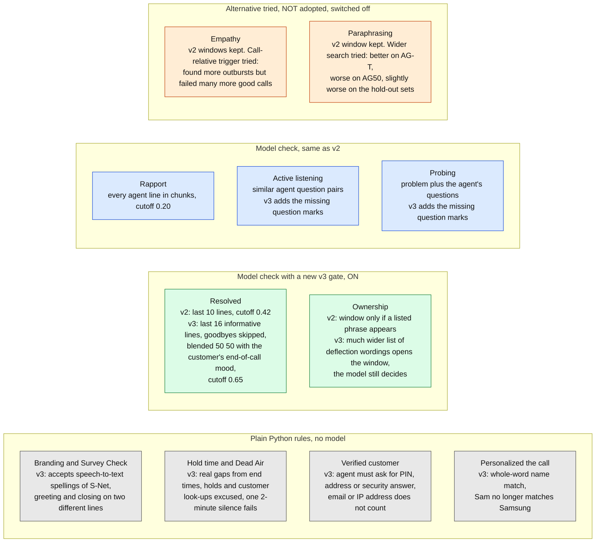

Switches: `gates` in `src/v3/config/v3.json`. `"mode": "v3"` uses the new window, `"mode": "v2"` the original one. Changing a switch needs no code change.

How the v3 Resolved score is formed (`src/v3/candidates/resolved.py`):

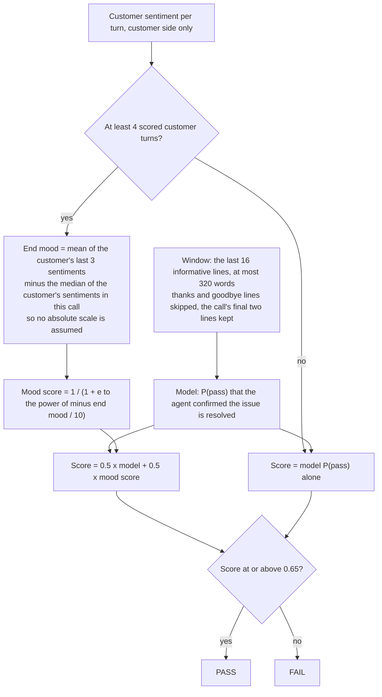

---

## 7. How the score is built

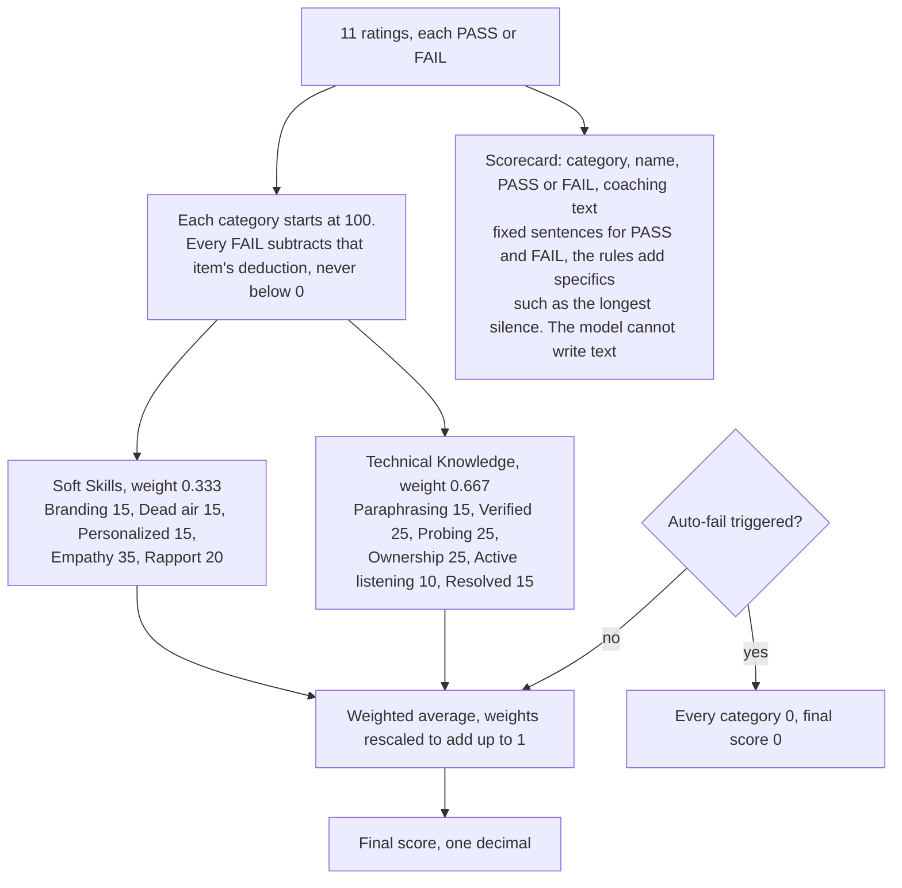

| Part | v2 | v3 |
|---|---|---|
| Deductions and weights | Read from the criteria (request or DB) | Read from `src/v3/config/criteria.json` |
| Matching a rating to its item | By the category name written on the rating; a tenant with other category names silently scores 100 | By item name against the criteria's own categories |
| No active criteria | Scores 100 | Not possible: the built-in set is always used |
| Auto-fail | `check_auto_fail` in `dynamic_evaluator.py`: substring match of fuck, shut up, idiot, get lost, stupid, hang up on agent text | `check_auto_fail` in `src/v3/rules.py`: word patterns with an allow-list ("that's not a stupid question", "please hang up and call back" do not trigger) |
| Extra output | none | `evidence_turns` per item, `meta` (flow, config version, model, gates, rows and words sent to the model, seconds, warnings) |

Deductions come from `resources/criteria_config.json` (v2 reference set) and `src/v3/config/criteria.json` (v3), which hold the same values.

---

## 8. How a new gate is chosen and switched on

This is how Resolved and Ownership were adopted and how Empathy and Paraphrasing were rejected. The same steps apply to any future change.

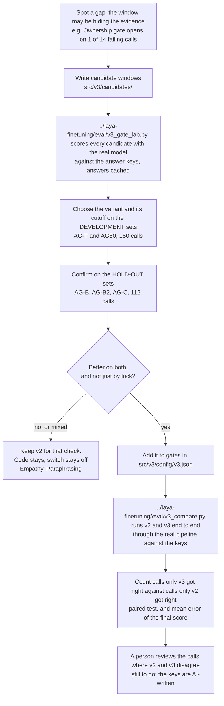

Result of the end-to-end comparison (all figures against AI-written keys; files `../laya-finetuning/runs/v3/e2e_*.jsonl`):

| Set group | Calls | The 11 items matching the key, v2 -> v3 | Better / worse | p | Mean final-score error |
|---|---|---|---|---|---|
| Development (AG-T, AG50) | 150 | 1389 -> 1407 of 1650 | 45 / 27 | 0.044 | 10.5 -> 9.9 points |
| Hold-out (AG-B, AG-B2, AG-C) | 112 | 1031 -> 1056 of 1232 | 46 / 21 | 0.003 | 11.0 -> 9.0 points |

Almost all of the gain is the Resolved check. The Resolved hold-out numbers were read before the variant was finally picked, so they are a confirmation with some selection in them, not a clean test.

---

## 9. How the model and the test sets were built

Where the weights and every set of test calls came from. Every answer key in this chain was written by an AI and none has been checked by a human.

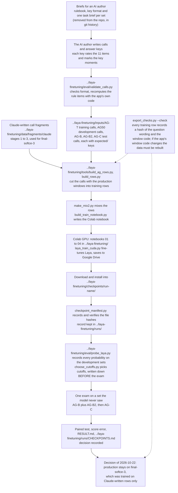

| Step | Where |
|---|---|
| Briefs | The rulebook, the key and marker format, worked examples and one task brief per set (AG-T, AG-B, AG-B2, AG-C) were removed on 2026-10-22 once the sets were sealed. They are in git history at commit `a7ace67`; the structure of an answer key is described in `CODEBASE_GUIDE.md` section 5 |
| Calls and keys | `../laya-finetuning/inputs/AG-T`, `../laya-finetuning/inputs/AG50`, `../laya-finetuning/inputs/AG-B`, `../laya-finetuning/inputs/AG-B2`, `../laya-finetuning/inputs/AG-C` (`expected/` folders hold the keys) |
| Row building | `../laya-finetuning/tools/build_ag_rows.py`, `build_rows.py`, `make_mix2.py`; rows in `../laya-finetuning/data/rows/` |
| Training | `../laya-finetuning/0x_train_eval*.ipynb` on Google Colab; `../laya-finetuning/tools/laya_train_cuda.py` |
| Weights | `../laya-finetuning/checkpoints/` (git-ignored, never pushed); catalogue `../laya-finetuning/runs/CHECKPOINTS.md` |
| Freeze check | `../laya-finetuning/tools/export_checks.py`; frozen file `../laya-finetuning/data/frozen/checks_frozen.json` |
| Probes and exams | `../laya-finetuning/eval/probe_laya.py`, `choose_cutoffs.py`, `cutoff_eval.py`; results under `../laya-finetuning/runs/` and `inputs/Test (results)/` |
| Why the frozen files must not change | `laya_inputs.py`, `rule_engine.py`, `laya_windows.py` and the question wording are hashed into the training data; v3 imports them and never edits them |
