# QA Pipeline — Where Laya Can Replace Ollama (llama3.1:8b)

Flowchart of the **as-implemented** evaluation pipeline (`src/services/dynamic_evaluator.py::evaluate_interaction`), with every stage labelled by whether the Laya model can take it over.
> **Historical (pre-migration) analysis.** This describes the Ollama pipeline as it was before version 10. The switch to Laya is now done; for the current pipeline see `README.md` and `Docs/ARCHITECTURE.md`.

It also differs from the Antigravity design doc (see [Differences from the design doc](#differences-from-the-antigravity-design-doc)).

**Status:** analysis only. Nothing in `src/` has been changed.

## Legend

| Tag | Colour | Meaning |
|---|---|---|
| `[LAYA]` | green | Binary yes/no decision currently made by Ollama. Laya can replace it. |
| `[LAYA*]` | amber | Laya can replace it, but there is an input-length or aggregation caveat. |
| `[KEEP]` | red | Laya cannot replace it (free-text generation or embeddings). It stays on Ollama. |
| `[NO LLM]` | blue | Already plain Python/regex. There is nothing to replace. |
| `[NEW]` | dashed green | New component this change would add. |

## Flowchart

```mermaid
flowchart TD
    classDef py fill:#dbeafe,stroke:#2563eb,stroke-width:2px,color:#0f172a
    classDef laya fill:#bbf7d0,stroke:#16a34a,stroke-width:3px,color:#0f172a
    classDef caveat fill:#fde68a,stroke:#d97706,stroke-width:3px,color:#0f172a
    classDef keep fill:#fecaca,stroke:#dc2626,stroke-width:3px,color:#0f172a
    classDef new fill:#f0fdf4,stroke:#16a34a,stroke-width:2px,stroke-dasharray:6 4,color:#0f172a

    IN["<b>INPUT</b> · POST /api/evaluate<br/>turns + sentiment_score + customer_name<br/>+ active criteria from DB"]:::py
    IN --> PARSE["<b>[NO LLM] Parse transcript</b><br/>turns · agent / customer lines<br/>first-10 slices · agent-only text"]:::py

    NEW["<b>[NEW] laya_adapter</b><br/>ask(text, question, polarity, threshold)<br/>returns PASS/FAIL + P(yes)<br/>every noul question carries explicit true/false criteria"]:::new

    subgraph S1["STAGE 1 · Deterministic rules — no LLM today"]
        direction LR
        R1["<b>[NO LLM]</b> Branding and Survey<br/>substring match"]:::py
        R2["<b>[NO LLM]</b> Hold time and Dead Air<br/>gap over 30s, 2 or more = FAIL"]:::py
        R3["<b>[NO LLM]</b> Verified customer<br/>regex PIN / address within 240s"]:::py
        R4["<b>[NO LLM]</b> Personalized call<br/>customer name in agent line"]:::py
    end

    subgraph S2["STAGE 2 · Snippet-gated checks — Python finds the snippet, an LLM judges it"]
        direction LR
        E1["<b>[NO LLM]</b> Empathy searchlight<br/>sentiment ≤ -15 or drop ≥ 8<br/>no apology in next 3 turns"]:::py
        E2["<b>[LAYA]</b> Verify empathy<br/>5-turn snippet · Ollama one word today"]:::laya
        A1["<b>[KEEP]</b> Active-listening gate<br/>difflib over 0.60 + embedding cosine over 0.70<br/>nomic-embed-text"]:::keep
        A2["<b>[LAYA]</b> Verify repeated question<br/>Ollama one word today"]:::laya
        O1["<b>[NO LLM]</b> Ownership filter<br/>28 deflection phrases"]:::py
        O2["<b>[LAYA]</b> Verify deflection<br/>Ollama one word today"]:::laya
        P1["<b>[NO LLM]</b> Rapport filter<br/>26 rude phrases"]:::py
        P2["<b>[LAYA]</b> Verify rudeness<br/>Ollama one word today"]:::laya
        E1 -->|snippet found| E2
        A1 -->|pair found| A2
        O1 -->|phrase hit| O2
        P1 -->|phrase hit| P2
    end

    subgraph S3["STAGE 3 · Context checks"]
        direction LR
        C1["<b>[KEEP]</b> Paraphrasing<br/>embedding cosine ≥ 0.50<br/>first 10 customer vs first 10 agent lines"]:::keep
        C2["<b>[LAYA*]</b> Probing<br/>no agent question = auto FAIL<br/>else problem + questions, Ollama one word today<br/>input may pass 512 tokens"]:::caveat
    end

    subgraph S4["STAGE 4 · Criteria batches — route remaining criteria by name"]
        direction LR
        B1["<b>[LAYA]</b> B1 · agent-only transcript<br/>custom tenant criteria<br/>empty with the default 11 items"]:::laya
        B2["<b>[LAYA]</b> B2 · last 30% of lines<br/>Confirmed the issue is resolved"]:::laya
        B3["<b>[LAYA*]</b> B3 · full transcript<br/>Escalation / Hostility, only if tenant adds them<br/>needs windowed predict_long"]:::caveat
    end

    PARSE --> S1 --> S2 --> S3 --> S4

    S2 -.->|asks Laya| NEW
    S3 -.->|asks Laya| NEW
    S4 -.->|asks Laya| NEW

    S4 --> POST["<b>[NO LLM] Merge ratings</b><br/>NOT_RATED becomes FAIL · deduction override<br/>profanity auto-fail: substring list on full transcript"]:::py
    POST --> COACH["<b>[KEEP] Coaching tips</b><br/>one batched free-text JSON call for all failed items<br/>user-facing text · stays on Ollama llama3.1"]:::keep
    COACH --> SCORE["<b>[NO LLM] Category scores · weights</b><br/>final scorecard JSON"]:::py
```



## Stage-by-stage decision

| # | Stage | How it is done today | Source | Verdict | Why |
|---|---|---|---|---|---|
| 1 | Parse transcript | Python | `dynamic_evaluator.py:110-158` | `[NO LLM]` | Nothing to replace. |
| 2 | Branding and Survey | Substring match | `rule_engine.py:6` | `[NO LLM]` | Deterministic. |
| 3 | Hold time and Dead Air | Python gap count | `rule_engine.py:44` | `[NO LLM]` | Deterministic. |
| 4 | Verified customer | Regex | `rule_engine.py:86` | `[NO LLM]` | Deterministic. |
| 5 | Personalized call | Substring match | `rule_engine.py:114` | `[NO LLM]` | Deterministic. |
| 6 | Empathy searchlight | Sentiment thresholds | `rule_engine.py:151` | `[NO LLM]` | Sentiment arrives pre-computed. There is no RoBERTa in this repo. |
| 7 | **Verify empathy** | Ollama, one word | `dynamic_evaluator.py:199` | `[LAYA]` | Binary question over a short snippet (about 5 turns). Fits Laya's 512-token window. |
| 8 | Active-listening gate | difflib + `nomic-embed-text` cosine | `rule_engine.py:132` | `[KEEP]` | Laya cannot produce embeddings. |
| 9 | **Verify repeated question** | Ollama, one word | `dynamic_evaluator.py:222` | `[LAYA]` | Binary question over a two-question snippet. |
| 10 | Ownership / Rapport filters | Regex phrase lists | `rule_engine.py:189`, `:206` | `[NO LLM]` | Keep as the cheap gate in front of Laya. |
| 11 | **Verify deflection** | Ollama, one word | `dynamic_evaluator.py:251` | `[LAYA]` | Binary question over the matched agent lines. |
| 12 | **Verify rudeness** | Ollama, one word | `dynamic_evaluator.py:273` | `[LAYA]` | Binary question over the matched agent lines. |
| 13 | Paraphrasing | Embedding cosine ≥ 0.50 | `dynamic_evaluator.py:205` | `[KEEP]` | Embedding similarity, not a language-model verdict. |
| 14 | **Probing** | Ollama, one word | `dynamic_evaluator.py:301` | `[LAYA*]` | Binary, but the customer problem plus all agent questions can pass 512 tokens. Use the multilingual checkpoint (1024 tokens) or trim the input. |
| 15 | **Batch B1 / B2** | Ollama JSON, regex-parsed | `dynamic_evaluator.py:347-350` | `[LAYA]` | Each criterion is PASS/FAIL. Laya answers N `noul` questions in one pass, so the `NOT_RATED` retry loop is no longer needed. |
| 16 | **Batch B3** | Ollama JSON, regex-parsed | `dynamic_evaluator.py:351` | `[LAYA*]` | Full transcript is too long for one window. Use `predict_long` or `max_len=8192`. The strongest-window probability drifts upward with window count, so calibrate it. |
| 17 | Evidence quote in the batch prompt | Requested, never read | `dynamic_evaluation_prompt.txt:24` | Drop | Nothing consumes it and Laya cannot produce it. |
| 18 | Merge ratings, deductions, profanity auto-fail | Python | `dynamic_evaluator.py:353-368`, `:550` | `[NO LLM]` | Deterministic. |
| 19 | **Coaching tips** | Ollama, free-text JSON | `dynamic_evaluator.py:370-391` | `[KEEP]` | Needs generated sentences, and they reach the UI. Laya's `output_tokens` is always 0. |
| 20 | Scoring and scorecard | Python | `dynamic_evaluator.py:571`, `:400-427` | `[NO LLM]` | Deterministic. |

### Net effect
- **Move to Laya:** 4 snippet verifications, Probing, and the whole batch path (B1/B2/B3). That is 5 single-word calls plus up to 3 JSON calls (each retried up to 3 times).
- **Stays on Ollama:** 1 coaching call, plus embeddings for Paraphrasing and the Active-listening gate. Ollama cannot be removed entirely.

## What Laya can and cannot do

Evidence is in `laya-test/laya` (`README.md`, `docs/questions-and-answers.md`, `examples/`).

- Laya is an encoder with a decision head, not a generative LLM. It cannot write text, quotes, explanations or embeddings.
- Question types:
  - `noul` returns P(yes) from 0 to 1. The caller picks the threshold.
  - `choice` returns a label with probabilities.
  - `score` returns an ordinal expected value.
- Many questions are answered in one forward pass (`examples/16_many_questions_one_pass.py`).
- Context windows:
  - `laya` (English) takes 512 tokens.
  - `laya-multilingual` takes 1024 tokens, and up to 8192 with `max_len=8192`.
  - `predict_long` windows longer text and reports the deciding window.

### Caveats that apply to this integration
1. **Every `noul` question needs explicit `criteria`** (`{"true": …, "false": …}`). On the English checkpoint a `noul` without criteria answers "no" whatever the text says (`README.md:1587`).
2. **Thresholds must be tuned.** Probabilities ship over-confident, so 0.5 is only a starting point. Treat roughly 0.4–0.6 as "unsure".
3. **Polarity differs per criterion.** Violation-based items (Ownership, Rapport, Active listening) FAIL on a high P(yes). Positive-evidence items (Empathy, Probing, Confirmed resolved) PASS on a high P(yes).
4. **Truncation is silent.** Check `usage["truncated"]` and fail safe when it is set.
5. **Accuracy on this QA wording needs checking.** Laya's own benchmarks show the base checkpoints near chance on its typed-decisions set. The repo has no human per-criterion labels (`tests/scoring_test/*.json` carry only a quality tier and `inputs/Test (results)/` holds Ollama's own outputs), so a synthetic gold set and a first out-of-the-box test now live in `laya-test/qa_eval/` (see `RESULTS.md` there).
6. **Criterion descriptions need rewriting.** The seeded descriptions for Probing and Confirmed say "Output YES or NO" and the batch prompt asks for JSON. These become Laya question text and `criteria`.

Illustrative question shape (not yet run against this data):
```python
questions = {
    "deflected": {
        "type": "noul",
        "instructions": "Does the agent blame another team, deflect responsibility, or refuse to help?",
        "criteria": {
            "true": "Agent blames another team, deflects, or refuses to help",
            "false": "Agent takes ownership and keeps working the problem",
        },
    }
}
```

## Differences from the Antigravity design doc

| Topic | Design doc | What the code actually does |
|---|---|---|
| Sentiment | RoBERTa searchlight | No RoBERTa in this repo. A per-turn `sentiment_score` must arrive in the input. A raw-string transcript has none, so Empathy can never fire. |
| Empathy snippet | 3 turns | The negative customer turn plus the next 4 turns. Skipped if the agent apologised within the next 3 turns. |
| Repeated-question search | TF-IDF | difflib ratio over 0.60 **and** embedding cosine over 0.70. |
| Paraphrasing | Cosine ≥ 0.30 | Cosine ≥ **0.50**, using `nomic-embed-text` through Ollama. |
| Phase 4 agent-only batch (Rapport, Probing, Ownership) | One LLM batch | Three separate keyword-gated one-word calls. B1 is empty with the default 11 criteria. |
| Phase 5 wrap-up | Last 30% of the transcript | Last 30% of **lines**. This is the only batch that runs with the default criteria. |
| Phase 6 Escalation / Hostility auto-fail | Always evaluated, auto-fail | Evaluated only if a tenant adds items with those names. Auto-fail needs the category name to contain "AUTO FAIL". Profanity auto-fail is a substring list run **after** all LLM work. |
| Phase 7 coaching | Batched, one sentence each | Matches. It skips Branding and Dead Air, and it overwrites the hard-coded tips written earlier. |

## Not part of this change (next phase)
- Build `laya_adapter` behind a config flag, keeping Ollama as the fallback.
- `qa-analysis/.venv` already has `torch` and `transformers` but not `laya`. Laya would need installing there, or running as a separate local service.
- Tune thresholds on human-reviewed labels and compare Laya against the current Ollama verdicts. (A synthetic first pass is in `laya-test/qa_eval/RESULTS.md`; the labels there are not human-verified.)
- Quirks noticed along the way, left alone:
  - `OLLAMA_TIMEOUT` is never read.
  - `download_model.py` (called by `setup.sh`/`setup.bat`) does not exist.
  - `/api/preview-prompt` breaks on list transcripts.
  - When Ollama is down, Active listening, Ownership and Rapport fail **open** to PASS, while Empathy, Probing and unrated batch items fail **closed** to FAIL.
