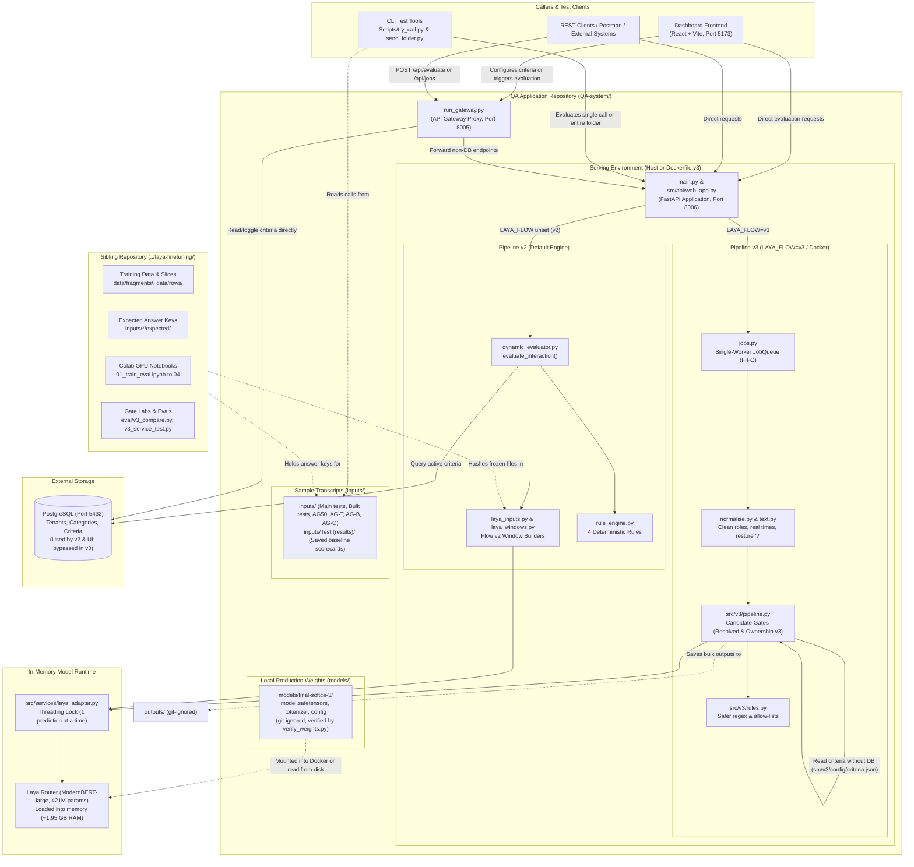
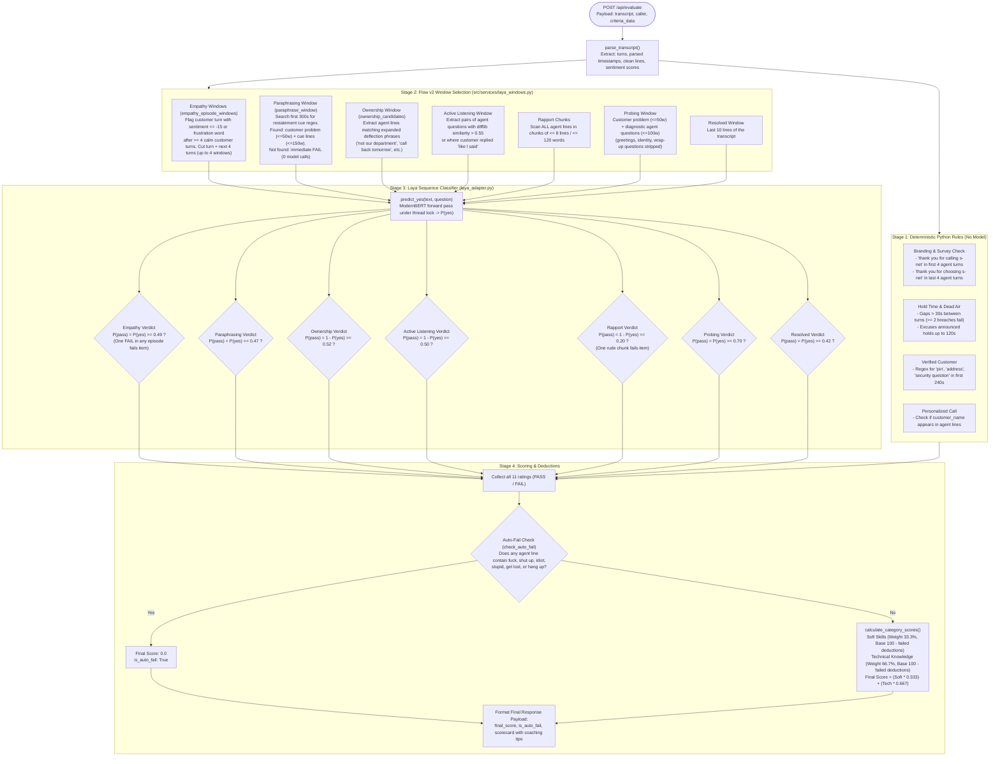
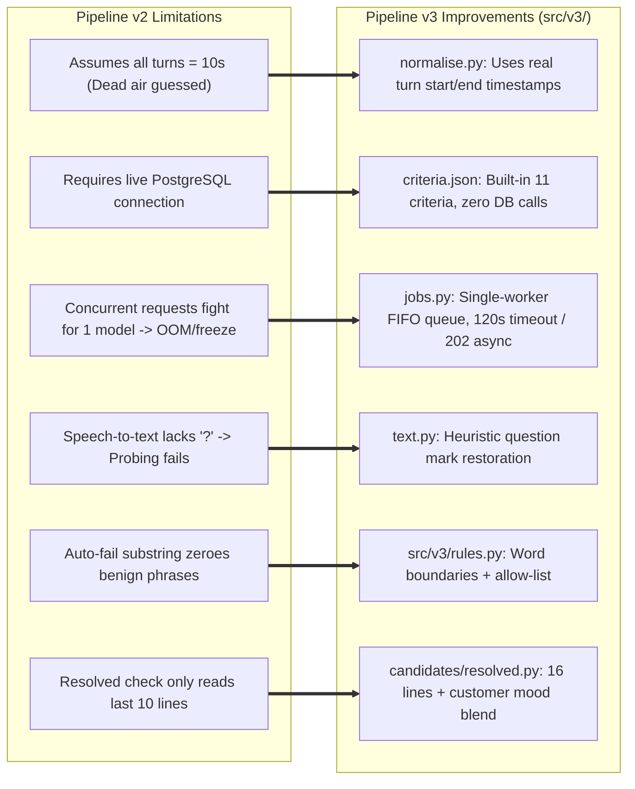

# QA System & Flow v2: Complete Architecture, Pipeline & Codebase Guide

> **Status on `main` (27 Oct 2026):** this page describes the earlier `app-v3` branch. On `main` the job queue (`/api/jobs`, `src/v3/jobs.py`) and `docker-compose.v3.yml` were removed: `/api/evaluate` is synchronous, tenant scorecards come from PostgreSQL with the built-in 11 items as fallback, and the Docker setup is `docker-compose.yml` with the fine-tuned weights mounted from `models/`. The current deployment guide is [`DEPLOYMENT_PLAN.md`](../DEPLOYMENT_PLAN.md).

> **Important Disclosure on Evidence & Answer Keys:**  
> Every accuracy figure, benchmark, and scorecard in this repository is measured against **AI-written answer keys** (generated by Claude or Antigravity), not human-labelled call recordings. Development sets (such as `AG50` and `AG-T`) were used to design the extractors and candidate gates, meaning numbers measured on them are optimistic. Always report results with their AI provenance.

---

## 1. Executive Summary & System Purpose

This repository hosts the **Automated QA Analysis System** for telephony customer support interactions (specifically tailored for tenant **S-Net**). 

### What the System Does
The service accepts a telephony call transcript (turns with speaker labels, start/end timestamps, and per-turn customer sentiment scores) and evaluates it against **11 distinct quality criteria** across two main categories:
1. **Soft Skills** (Base Weight: 33.3%)
2. **Technical Knowledge** (Base Weight: 66.7%)

It calculates points lost through failed deductions (starting at 100 per category), detects gross agent misconduct (auto-fail profanity/insult detection), and produces a **0–100 final score** alongside an actionable, line-item **scorecard** with coaching feedback.

### The Architectural Shift: Replacing Ollama with Fine-Tuned Laya
* **The Legacy Engine (App Versions $\le 9$):** Evaluated calls using **Ollama** running `llama3.1` (8B generative model) combined with `nomic-embed-text`. While reasonably accurate (error rate ~9.2 points on golden calls), it took **~6.4 minutes per call** on CPU, had high memory overhead, and suffered from generative hallucinations.
* **The Modern Engine (App Version 10+):** Replaces Ollama with **Laya** (`convaiinnovations/laya`), a local, non-generative, yes/no sequence classifier built on a **ModernBERT-large encoder** (421M parameters, fp16 ~808 MB, ~1.95 GB RAM working set).
* **Speedup & Privacy:** Grading time dropped from **386 seconds to ~15 seconds per 20-minute call on CPU** (25x speedup), running completely on-premises with no GPU required for inference.
* **The Fine-Tuning Need:** Untrained stock Laya produced an unacceptably high error rate (16.3 points) on long calls. Through fine-tuning on targeted synthetic pairs and restructuring input windows ("Flow v2"), Laya matched Ollama's grading accuracy without regression.

### The Two-Repository Architecture
As of October 2026, the codebase is cleanly decoupled into **two independent sibling repositories**:
1. **`QA-system/`** (`nimjj/QA-system`, branch `app-v3`): **The QA Application.** Houses the serving runtime (FastAPI), deterministic rule engine, Flow v2 windows, Pipeline v3 engine, Docker container setup, REST test harness, dashboard frontend, and production model weights in `models/final-softce-3`.
2. **`laya-finetuning/`** (`nimjj/laya-finetuning`, branch `separated-from-qa-system`): **The ML & Research Sibling.** Houses synthetic training data generation, Colab GPU training notebooks (`01`–`04`), evaluation benchmarks (`laya_eval`), candidate gate labs, answer keys, and experimental checkpoints.

---

## 2. Untangling the Terminology: Versions, Flows & Models

To navigate the codebase without confusion, distinguish between these four separate version concepts:

| Term | What It Refers To | Active Production State |
|---|---|---|
| **App Versions (v1 – v10.2)** | Historical Git branches of the monolithic service. Version 10 removed Ollama; version 10.2 introduced Laya fine-tuning and frozen checks. | Branch `app-v3` |
| **Pipeline v2 vs v3** | **The execution architecture around the evaluation.**<br>• **Pipeline v2** (`src/services/dynamic_evaluator.py`): Synchronous, reads criteria from PostgreSQL or inline request, assumes 10s turn durations.<br>• **Pipeline v3** (`src/v3/pipeline.py`): Asynchronous single-worker queue (`src/v3/jobs.py`), zero-database dependency (uses `src/v3/config/criteria.json`), cleans turn timestamps/roles, restores question marks, Dockerized. | **Pipeline v2 is default**; switch to v3 via `LAYA_FLOW=v3`. |
| **Flow v1 vs Flow v2** | **How transcript snippets are selected for Laya ("Windows").**<br>• **Flow v1**: Fixed line/word cuts (e.g. first 50 customer words, last 10 lines).<br>• **Flow v2** (`src/services/laya_windows.py`): Dynamic, call-structure-driven snippet extraction for Empathy (per-outburst), Paraphrasing (cue search), and Ownership (broad deflection list). | **Flow v2 is active** whenever `LAYA_CHECKPOINT` is set. |
| **Model Checkpoints** | The weights folder in `models/`:<br>• `stock`: Untrained base Laya (`convaiinnovations/laya` rev `7b928d82`).<br>• `final-softce-3`: **Production choice.** Stage 3 Claude-trained weights in `models/final-softce-3`.<br>• `ft5` / `ft6`: Experimental retrains on Antigravity data in `../laya-finetuning/checkpoints/` (tied with `final-softce-3`, kept for reference). | `models/final-softce-3` |

---

## 3. High-Level System Architecture

The following diagram illustrates how callers, containers, the database, and the decoupled sibling repositories interact:



---

## 4. Flow v2 Diagram: Call Evaluation Lifecycle

Flow v2 dictates how an incoming transcript is structured and fed to Laya. The key insight of Flow v2 is that **Laya has a strict 512-token context window (roughly 340 words)**: sending arbitrary text chunks caused 90% of grading errors. Flow v2 dynamically locates the decisive turns.



---

## 5. Evolution to Pipeline v3 (`src/v3/`) & Docker Architecture

While Flow v2 refined the model's snippet extraction, **Pipeline v3** addresses system-level operational flaws and adds production containerization:



### Key Innovations in Pipeline v3 Candidate Gates:
1. **Resolved Check (v3 Gate: `subst16` + Mood Blend):**
   Instead of just the last 10 lines, v3 extracts the **last 16 informative lines** (ignoring pleasantries/goodbyes) and calculates a **50/50 blend**:
   $$\text{Final Score} = 0.5 \times P_{\text{model}}(\text{pass}) + 0.5 \times \text{Mood Score}$$
   The customer mood score is computed as:
   $$\Delta_{\text{mood}} = \text{mean}(\text{last 3 customer sentiments}) - \text{median}(\text{all customer sentiments in call})$$
   $$\text{Mood Score} = \frac{1}{1 + e^{-\Delta_{\text{mood}} / 10}}$$
   Pass cutoff on the blended score is **0.65**.
2. **Ownership Check (v3 Gate: `wide`):**
   Significantly broadens the regex pattern opening the window to capture evasive phrases ("that's the vendor's problem", "nothing we can do", "you'll have to wait"), doubling fault detection on unseen calls.
3. **Dockerized Deployment:**
   Via `docker-compose.v3.yml`, the v3 service runs as a self-contained container listening on port `8006`, with `models/` mounted from the host.

---

## 6. The 11 QA Evaluation Criteria Breakdown

| # | Criterion | Category | Deduction | Evaluator | Flow v2 Extractor / Window Logic | Cutoff | Yes Means |
|---|---|---|---|---|---|---|---|
| **1** | **Branding & Survey Check** | Soft Skills | 15 pts | Rule | First 4 and last 4 agent lines checked for exact greeting/closing strings. | N/A | PASS |
| **2** | **Hold Time & Dead Air** | Soft Skills | 15 pts | Rule | $\ge 2$ silent gaps $> 30\text{s}$ fail. Announced holds exempt up to 120s. | N/A | PASS |
| **3** | **Personalized Call** | Soft Skills | 15 pts | Rule | Customer name string must appear in an agent line. | N/A | PASS |
| **4** | **Empathy & Acknowledgment** | Soft Skills | 35 pts | Laya | Up to 4 windows: customer turn with sentiment $\le -15$ or frustration word after $\ge 4$ calm turns, plus next 4 lines. | 0.49 | PASS |
| **5** | **Build Rapport & Professionalism** | Soft Skills | 20 pts | Laya | Consecutive chunks of all agent lines ($\le 8$ lines / $\le 120$ words). One rude chunk fails the call. | 0.20 | FAIL |
| **6** | **Paraphrasing** | Technical | 15 pts | Laya | First 300s restatement cue regex. If found: customer problem ($\le 50\text{w}$) + agent restatement ($\le 150\text{w}$). | 0.47 | PASS |
| **7** | **Verified Customer** | Technical | 25 pts | Rule | Agent must ask for PIN, address, or security question in first 240s. | N/A | PASS |
| **8** | **Probing** | Technical | 25 pts | Laya | Customer problem ($\le 50\text{w}$) + agent diagnostic question sentences ($\le 100\text{w}$). No questions = FAIL. | 0.70 | PASS |
| **9** | **Took Ownership** | Technical | 25 pts | Laya | Agent lines matching deflection phrases (`"not my department"`, `"call back"`). No match = PASS. | 0.52 | FAIL |
| **10** | **Active Listening** | Technical | 10 pts | Laya | Up to 3 pairs of similar agent questions ($\text{difflib} > 0.55$) with customer intermediate answer ($\le 40\text{w}$). | 0.50 | FAIL |
| **11** | **Confirmed Issue Resolved** | Technical | 15 pts | Laya | Last 10 lines of transcript (v2) or last 16 informative lines + mood blend (v3). | 0.42 (v2)<br>0.65 (v3) | PASS |

* **Auto-Fail:** If an agent line contains profanity or verbal abuse (`fuck`, `shut up`, `idiot`, `stupid`, `get lost`, `hang up`), the entire call receives a score of **0.0**.

---

## 7. Deep-Dive: The Sibling Laya Knowledge Base (`../laya-finetuning/docs/`)

The documentation regarding model training, generation rules, and data provenance lives in the sibling repository `../laya-finetuning/docs/`:

### 1. `DATA_PLAN.md` (The Training Roadmap & Shift)
* **Historical Pivot:** The original plan envisioned human-in-the-loop labelling and Gemini-generated test sets. Due to tight schedules, **human labelling was dropped**, and Claude generated synthetic training/eval calls across a matrix of 12 industries, 8 agent personas, and varied customer moods.
* **Volume Ramp (Stage 1 to 3):** Commenced with 1,269 train rows / 273 dev / 396 test, expanding to full staged calls to eliminate length mismatches.
* **Replay Rows as Drift Guard:** Included ~300 replay rows with the stock model's own probabilities as soft targets (`gold`) to prevent the model from catastrophic forgetting on custom tenant criteria.
* **Hardware & laya-train Bug:** Highlighted the critical bug in `laya-train v0.4.0` where the evaluation step runs on CPU while training starts on GPU (causing an `index_select` tensor device mismatch). Fixed via the wrapper `tools/laya_train_cuda.py`.

### 2. `GENERATION_NOTES.md` (Pilot Shortcut Discoveries & Rules)
* **The Danger of Synthetic Shortcuts:** Running a bag-of-words (BoW) probe revealed that synthetic models cheat by using superficial signals rather than genuine reasoning:
  - *Empathy Length Shortcut (BoW 0.88):* Synthetic warm replies were consistently long; cold replies were curt.
  - *Resolved Word Shortcut (BoW 0.93):* PASS endings always contained "resolved/fixed/yes"; FAIL endings never did.
* **Countermeasures Mandated for Full Generation:**
  - Strict length balancing between PASS and FAIL snippets.
  - At least 30% **hard negative pairs**: e.g., FAIL endings containing the word "resolved" (customer: *"you said it was resolved, but my screen is still black"*), and PASS endings without lexical markers.

### 3. `LABELLING_GUIDE.md` (Ground Truth Definition)
* **The Golden Rule:** Judge only the short snippet Laya receives, not what transpired elsewhere in the call.
* **Tone Beats Words:** Trigger words (like `"obviously"`, `"as I said"`) do not constitute automatic failures; context determines whether it is hostile scolding or polite reassurance.
* **The Active Listening Rule:** Re-asking for identical information fails; re-checking a status that may have changed after a reboot passes.

### 4. `NEW_PC_SETUP.md` (Environment & Deployment Runbook)
* **Two Repositories:** Explains cloning both `QA-system` and `laya-finetuning` side-by-side.
* **Dependencies:** Python 3.14, `transformers==5.16.1`, and `laya` pinned at commit `3cf26cb`.
* **Weights Integrity:** Weights must not be pushed to Git; they are downloaded from Google Drive into `QA-system/models/final-softce-3/` and verified with `python Scripts/verify_weights.py`.
* **Google Drive Warning:** Never run the active Git workspace inside a Google Drive synced folder (cloud sync previously corrupted `.git` and reverted uncommitted code).

### 5. `PHASE0_ANSWER_KEY.md` (Honesty on the 4 Golden Calls)
* Discloses that the 4 "Main Golden Calls" were graded by Claude without independent human validation.
* Confirmed three contested verdicts: 2-BRAND (FAIL), 3-EMP (FAIL), and 4-AL (PASS under the strict re-ask rubric).

---

## 8. Two-Repository Codebase Map

```
D:\CIAP\QA\
├── QA-system/                              # THE QA APPLICATION REPOSITORY (nimjj/QA-system)
│   ├── main.py                             # QA service entry point (port 8006)
│   ├── run_gateway.py                      # API gateway reverse proxy (port 8005)
│   ├── requirements.txt                    # Pinned dependencies
│   ├── Dockerfile.v3                       # Single-container v3 Dockerfile
│   ├── docker-compose.v3.yml               # v3 Docker Compose config (models mounted)
│   ├── requirements-docker.txt             # CPU-only pinned dependencies for Docker
│   ├── setup.bat / setup.sh                # Environment initialization scripts
│   ├── CLAUDE.md                           # Assistant instructions and safety rules
│   │
│   ├── models/                             # PRODUCTION MODEL WEIGHTS (git-ignored)
│   │   ├── README.md                       # Weight sharing and provenance documentation
│   │   └── final-softce-3/                 # Production checkpoint (model.safetensors, etc.)
│   │
│   ├── src/
│   │   ├── api/                            # FastAPI endpoints (web_app.py) & JSON logger
│   │   ├── gateway/                        # API gateway proxy
│   │   ├── db/                             # PostgreSQL connection (v2 only)
│   │   ├── services/                       # PIPELINE V2 & SHARED MODEL ACCESS (FROZEN MODULES)
│   │   │   ├── dynamic_evaluator.py        # evaluate_interaction(), LAYA_CHECKS [FROZEN]
│   │   │   ├── laya_inputs.py              # parse_transcript(), build_laya_inputs() [FROZEN]
│   │   │   ├── laya_windows.py             # Flow v2 structure-based window builders [FROZEN]
│   │   │   ├── rule_engine.py              # 4 deterministic Python rules [FROZEN]
│   │   │   └── laya_adapter.py             # Thread-safe Laya model wrapper (predict_yes)
│   │   └── v3/                             # PIPELINE V3 (NEW ASYNC PIPELINE)
│   │       ├── pipeline.py                 # evaluate_v3() end-to-end evaluation
│   │       ├── jobs.py                     # Single-worker asynchronous JobQueue
│   │       ├── normalise.py                # Transcript validation, role mapping, real timestamps
│   │       ├── rules.py                    # Regex rules with boundary checks and allow-lists
│   │       ├── scoring.py                  # Schema-driven category scoring without DB
│   │       ├── text.py                     # Question mark restoration for STT transcripts
│   │       ├── candidates/                 # Candidate gates (resolved.py, ownership.py)
│   │       └── config/                     # v3.json (limits, gate switches), criteria.json
│   │
│   ├── inputs/                             # CALL TRANSCRIPTS ACROSS ALL TEST SETS
│   │   ├── Main tests/                     # 4 golden calls (excellent, good, okay, bad)
│   │   ├── Bulk tests/                     # 64 targeted defect regression calls (b_*)
│   │   ├── AG50/, AG-T/, AG-B/, AG-C/      # Antigravity call transcripts
│   │   ├── Eval50/, Tough checks/          # Benchmark transcripts
│   │   └── Test (results)/                 # Historical and saved v3 golden results
│   │
│   ├── outputs/                            # REST output responses from send_folder.py (git-ignored)
│   │
│   ├── Scripts/                            # TEST & VERIFICATION UTILITIES
│   │   ├── verify_weights.py               # Stdlib SHA-256 weight integrity checker
│   │   ├── try_call.py                     # Grades 1 call and prints human scorecard
│   │   ├── send_folder.py                  # Evaluates entire folder of calls via REST
│   │   ├── batch_test.py                   # Legacy batch runner
│   │   └── compare_results.py              # Compares scorecard JSONs against expected
│   │
│   ├── Docs/                               # APPLICATION DOCUMENTATION
│   │   ├── README.md                       # Documentation index
│   │   ├── CODEBASE_GUIDE.md               # Team onboarding guide
│   │   ├── FLOW_DIAGRAMS.md                # Flow diagrams
│   │   ├── DOCKER.md                       # Docker deployment runbook
│   │   ├── V3.md                           # Pipeline v3 technical specification
│   │   └── SYSTEM_AND_FLOW_V2_GUIDE.md     # (This document) Master reference
│   │
│   └── tests/                              # 106 automated offline unit tests
│
└── laya-finetuning/                        # SIBLING REPOSITORY: MODEL TRAINING & RESEARCH
    ├── checkpoints/                        # Experimental checkpoints (ft5, ft6)
    ├── data/                               # Raw fragments, rows, checks_frozen.json
    ├── docs/                               # DATA_PLAN.md, LABELLING_GUIDE.md, NEW_PC_SETUP.md
    ├── eval/                               # v3_compare.py, v3_service_test.py, golden.py
    ├── inputs/*/expected/                  # Expected answer keys for all call sets
    ├── runs/                               # CHECKPOINTS.md catalogue, RESULT.md per run
    └── tools/                              # export_checks.py, build_rows.py, laya_train_cuda.py
```

---

## 9. Operations, Verification & Command Reference

### 1. Verify Model Weights (Always Run First)
Uses standard library SHA-256 to ensure `models/final-softce-3/` is intact:
```powershell
cd d:\CIAP\QA\QA-system
.\.venv\Scripts\python Scripts\verify_weights.py
```
*Expected Output:* Prints `OK` for all 6 files and ends with `ALL FILES MATCH`.

### 2. Verify Extractor Integrity (Frozen Check)
Verifies that `laya_inputs.py`, `rule_engine.py`, `laya_windows.py`, and question wordings match the frozen hashes in the sibling repository:
```powershell
cd d:\CIAP\QA\QA-system
.\.venv\Scripts\python ..\laya-finetuning\tools\export_checks.py --check
```
*Expected Output:* `MATCH: all` and `MATCH: inputs`.

### 3. Run Automated Unit Tests (Offline, Fast)
Validates all rules, scoring logic, job queue, and input normalizers (~1 second):
```powershell
cd d:\CIAP\QA\QA-system
.\.venv\Scripts\python -m unittest discover -s tests/unit -t .
```
*Expected Output:* `Ran 106 tests ... OK`.

### 4. Running the Service

#### Option A: Run in Docker (Pipeline v3, No Database)
```bash
docker compose -f docker-compose.v3.yml up -d --build
curl http://localhost:8006/ready        # Wait for "status": "ready" (~10s)
```

#### Option B: Run Locally on Host
```powershell
# Pipeline v2 (default):
.\.venv\Scripts\python main.py

# Or Pipeline v3 (JobQueue, built-in criteria, no database):
$env:LAYA_FLOW = "v3"
$env:LAYA_CHECKPOINT = "models/final-softce-3"
.\.venv\Scripts\python main.py
```

### 5. Test with CLI Tools (While Server is Running)

#### Test a Single Call (Human-Readable Scorecard)
```powershell
.\.venv\Scripts\python Scripts\try_call.py "inputs/Main tests/gold_01_excellent_22min.json"
```
*Expected Output:* Prints summary scorecard with a score of `100.0` (all 11 items PASS).

#### Evaluate an Entire Folder via REST
```powershell
.\.venv\Scripts\python Scripts\send_folder.py "inputs/Main tests"
```
*Expected Output:* Evaluates all calls in the folder, writes individual responses to `outputs/Main tests/`, and generates `outputs/Main tests/_summary.csv`.
